> **SUPERSEDED (Nov 2026):** this plan describes the rejected D4 design (Q only if exactly diagonalizing). The implementation uses joint approximate diagonalization and a fit-basis solver; see the review plan and memory note symm-prec-truncation-nov2026.

# End-to-End Review & Implementation Plan: `symmetry_prec` (`symm_prec`) Block Reduction & Hybridization Fitting Across `rspt2spectra`, `impurityModel`, and `impmod_interface`

## 0. Design decisions (settled 2026-11-08)

- **D1 (Unified relative off-diagonal metric)** Off-diagonal couplings in both $\Delta(\omega)$ and static one-body matrices $H$ ($H_{\text{DFT}}$ or $M = h_{\text{imp}} + V^\dagger V$) are compared against `symm_prec` (`tol`) using dimensionless relative metrics on $[0, 1]$:
  - For $\Delta(\omega)$, evaluated within the active fitting window `x_lim` when provided:
    $$\frac{\|\Delta_{ij}(\omega)\|_{L_2(\text{window})}}{\max_k \|\Delta_{kk}(\omega)\|_{L_2(\text{window})}} > \text{tol}$$
  - For a static matrix $H$, normalized by the crystal-field splitting scale per spin/component (with a $10^{-10}$ absolute floor so an isotropic/zero matrix never divides by zero or amplifies floating-point roundoff):
    $$\frac{|H_{ij}|}{\max\!\left(\text{scale}(H),\, 10^{-10}\right)} > \text{tol}, \qquad \text{scale}(H) = \max_k |\lambda_k(H_{\text{herm}}) - \bar{\lambda}| \;\text{or}\; \max_k |H_{kk} - \bar{H}_{\text{block}}|$$
- **D2 (Separation of `tol` vs. `equiv_tol`)** The block-connectivity threshold `tol` (`symm_prec`) is separated from the block-equivalence and exact-symmetry tolerance `equiv_tol = 1e-6`:
  - `tol` (`symm_prec`) controls `get_blocks` and `project_to_blocks` (which off-diagonal couplings are truncated to zero).
  - `equiv_tol = 1e-6` controls `get_identical_blocks`, `get_transposed_blocks`, `get_particle_hole_blocks`, and `detect_block_symmetry` in `fit_hyb`. Raising `symm_prec` never falsely merges non-degenerate blocks into `identical_blocks` and never truncates the SVD inside `_compress(block_hyb, tol)` during intra-block VarPro fitting.
- **D3 (Bath-state coverage floor in `get_state_per_inequivalent_block`)** In `rspt2spectra/src/rspt2spectra/hyb_fit.py`, each pole energy level $e_b$ in an $n_{\text{block}} \times n_{\text{block}}$ block carries a full-rank $(n_{\text{block}} \times n_{\text{block}})$ PSD residue matrix $A_b = V_b^\dagger V_b$ that expands in `flatten_star_levels` into $n_{\text{block}}$ bath orbitals. The minimum coverage floor for hybridizing blocks is set to `1` pole level (`states[hybridizing] = np.maximum(states[hybridizing], 1)`), providing $n_{\text{block}}$ bath orbitals (1 bath orbital per impurity orbital in the block) instead of `orbitals_per_block` pole levels ($n_{\text{block}}^2$ bath orbitals).
- **D4 (Block-preserving `prepare_hyb_fit` & `block_diagonalize_hyb`)** `prepare_hyb_fit` first partitions `(hyb, H_local)` into blocks at `tol = symm_prec` (within `x_lim`) and zeroes off-block couplings across distinct blocks via `project_to_blocks`. Within each block, `block_diagonalize_hyb` only applies a candidate unitary $Q_{\text{block}}$ if it diagonalizes `(block_hyb, block_H_local)` across all frequencies to within `equiv_tol = 1e-6` (keeping $Q_{\text{block}} = I$ otherwise). Thus $Q$ is strictly block-diagonal with respect to `block_structure.blocks`, and `v = v @ Q.conj().T` in `assemble_h0` never leaks couplings across distinct blocks.
- **D5 (Preserving `symm_prec` blocks in `impurityModel`, `impmod_interface`, and archive replays)**
  - `parse_solver_line` accepts both `symm_prec` and `symmetry_prec` (storing the canonical key `"symm_prec"`).
  - `symm_prec` is forwarded to `BasisOptions`, `prepare_solver_basis`, and consumed from HDF5 archives in `real_workload.py` (moved from `_BATH_FIT_ONLY` to `_CONSUMED_ATTRS`).
  - `impurity_symmetry_rotation` only rotates a connected component of `h_imp` when that rotation splits the bath-dressed matrix $M = h_{\text{imp}} + V^\dagger V$ on that component into $>1$ sub-blocks at `tol`.
  - `reconcile_block_structure_with_interaction` scales the block-merging threshold on the $M$-dependent probes $P_1, P_2$ with `symm_prec` (while keeping `1e-8` on the $M$-independent probes $P_0, P_3, P_4$ for non-Slater–Condon interactions).

---

## 1. Context and scope

> Written 2026-11-08 from a three-repo audit and verified against `/home/johan/Programming/impmod_tests/superlattice/LMO_stressed_bulk`. Line numbers are as of `impmod_interface` `development` `a8da6d5`, `rspt2spectra` `master` `3673241`, and `impurityModel` `master` `a9a9c3a6`.

In distorted crystal structures—such as the orthorhombically distorted / epitaxially strained $\text{LaMnO}_3$ superlattice in `LMO_stressed_bulk/impmod/` and `LMO_stressed_bulk/base/`—the local Kohn–Sham Hamiltonian $H_{\text{DFT}}$ and hybridization function $\Delta(\omega)$ deviate from ideal cubic ($O_h$) symmetry due to $\text{MnO}_6$ octahedral rotations, Jahn–Teller distortions, and lower supercell point-group symmetry. Consequently, small off-diagonal matrix elements appear between the nominal $e_g$ and $t_{2g}$ manifolds (and within them), collapsing the one-body block structure into a single $5 \times 5$ block per spin (`[[0, 1, 2, 3, 4], [5, 6, 7, 8, 9]]`).

The intended purpose of `symm_prec` (`symmetry_prec`) is to let the user specify a threshold below which off-diagonal couplings in $H_{\text{DFT}}$ and $\Delta(\omega)$ are neglected, reducing the $5 \times 5$ block per spin into smaller decoupled blocks—such as $2\times 2 + 3\times 3$, $3\times 3 + 1\times 1 + 1\times 1$, $2\times 2 + 1\times 1 + 1\times 1 + 1\times 1$, or $5 \times (1\times 1)$—throughout both **hybridization bath fitting** (`rspt2spectra`) and the **many-body ED solve** (`impurityModel`).

---

## 2. End-to-End Root-Cause Analysis (10 Bugs Identified)

```mermaid
flowchart TD
    A["RSPt out & hyb files<br/>(LMO_stressed_bulk)"] -->|"Bug 9: impmod/green.inp uses basis tag 0 (spherical)<br/>with corr_to_cf = I"| B["impmod_interface: solve_Dirty()<br/>lib.py:1244-1420"]
    B -->|"Bug 10: symmetry_prec alias missing;<br/>hyb_fingerprint omits H_dft & tol"| C["rspt2spectra: prepare_hyb_fit()<br/>h0.py:43-97 / lib.py:1825"]
    C -->|"Bug 1: block_diagonalize_hyb()<br/>utils.py:252-291"| D["Single-pole eigh(Re Δ(ω0)) scrambles 5x5 basis;<br/>2D np.diag bug & global triu index mismatch"]
    D -->|"Bug 2 & Bug 3: build_block_structure()<br/>block_structure.py:252, 858"| E["Un-windowed rel L2 norm on Δ(ω) vs abs Ry on H_dft;<br/>same tol reused for identical_blocks merges inequivalent orbitals"]
    E -->|"Bug 4: get_state_per_inequivalent_block()<br/>hyb_fit.py:508-600 + offdiagonal.py:860"| F["n_block^2 bath explosion: each pole level expands to<br/>n_block bath orbitals, so states >= n_block yields 50 baths at :baths 1!"]
    F -->|"Bug 5: detect_block_symmetry()<br/>symmetries.py:238, 564 / hyb_fit.py:257"| G["Passing loose symmetry_tol truncates SVD in _compress(),<br/>collapsing 2x2 / 3x3 block fit to scalar * I"]
    G -->|"Bug 6 & Bug 7: assemble_h0() & scripts/build_h0.py<br/>h0.py:275-350 / build_h0.py:475-527"| H["H_imp off-block terms NEVER zeroed; V @ Q^H re-couples all orbitals;<br/>scripts/build_h0.py skips flatten_star_levels()"]
    H -->|"block_structure discarded at lib.py:1417"| I["impurityModel: prepare_solver_basis()<br/>solver_basis.py:179-310"]
    I -->|"Bug 8: impurity_symmetry_rotation() &<br/>reconcile_block_structure_with_interaction()<br/>symmetries.py:338, 848, 1035 / block_structure.py:264"| J["get_blocks() drops mat & tol; hardcoded 1e-10 rotation;<br/>interaction probe (tol=1e-8) merges 2x2+3x3 back to 5x5"]
```



### 2.1 Bugs in `rspt2spectra` Pre-Processing & Block Discovery (`utils.py`, `block_structure.py`, `h0.py`)

#### Bug 1: `block_diagonalize_hyb` (`rspt2spectra/src/rspt2spectra/utils.py:252-291`) has two array-indexing bugs and scrambles the crystal-field basis
1. **Line 277 dimensionality bug**:
   ```python
   if np.max(np.abs(block_hyb - np.diag(np.diagonal(block_hyb, axis1=1, axis2=2)))) < tol:
   ```
   Because `block_hyb` has shape $(N_\omega, n_b, n_b)$, `np.diagonal(block_hyb, axis1=1, axis2=2)` is a **2D array** of shape $(N_\omega, n_b)$. Passing a 2D array to `np.diag(...)` extracts its main diagonal—a **1D vector** of length $n_b$ (the first $n_b$ frequency points!)—rather than constructing a 3D diagonal tensor. The subtraction broadcasts $(N_\omega, n_b, n_b) - (n_b,)$, comparing all frequencies against the first $n_b$ frequencies so the early-exit check almost never triggers.
2. **Line 281 global-vs-block slice & single-frequency diagonalization**:
   ```python
   upper_triangular_hyb = np.triu(hyb_herm, k=1)
   ind_max_offdiag = np.unravel_index(np.argmax(np.abs(upper_triangular_hyb), axis=None), block_hyb.shape)
   _, Q_block = sp.linalg.eigh(block_hyb[ind_max_offdiag[0], :, :])
   ```
   First, `np.triu(hyb_herm, k=1)` is computed on the **full** matrix `hyb_herm` instead of `block_hyb`, and its flat argmax index is unraveled using `block_hyb.shape` (which raises `ValueError` or indexes the wrong frequency whenever $n_b < n_{\text{orb}}$). Second, diagonalizing $\text{Re}\,\Delta(\omega_0)$ at a single sharp pole $\omega_0$ (for `Mn8` in `LMO_stressed_bulk/base`, $\omega_0 = -0.363\,\text{Ry}$) chooses a basis where $\text{Re}\,\Delta(\omega_0)$ has accidental near-degeneracies. Because $[\text{Re}\,\Delta(\omega_0), H_{\text{DFT}}] \neq 0$ and $[\text{Re}\,\Delta(\omega_0), \Delta(\omega)] \neq 0$ in a distorted crystal, rotating by $Q$ **increases** the off-diagonal elements of $H_{\text{DFT}}$ from $0.0062\,\text{Ry}$ to $0.0092\,\text{Ry}$ and mixes all 5 orbitals.
3. **Ignores $\text{Im}\,\Delta(\omega)$ and $H_{\text{local}}$**: `block_diagonalize_hyb` computes `blocks = get_blocks(hyb_herm, tol=tol)` using only the Hermitian part of $\Delta(\omega)$ and ignoring $H_{\text{local}}$. When `prepare_hyb_fit` (`h0.py:83-94`) subsequently calls `build_block_structure(phase_hyb, mat=H_local_Q, tol=tol, w=w)`, $Q$ is a dense $5\times 5$ unitary that is **not** block-diagonal with respect to `block_structure.blocks`.

#### Bug 2: Inconsistent off-diagonal metrics (dimensionless relative $L_2$ norm vs. absolute Ry) and un-windowed frequency mesh in `get_n_blocks_block_indices_mask` (`rspt2spectra/src/rspt2spectra/block_structure.py:252-292`)
In `rspt2spectra/src/rspt2spectra/block_structure.py:252-292`, an off-diagonal edge $(i, j)$ is kept if **either**:
$$\frac{\|\Delta_{ij}(\omega)\|_{L_2(w)}}{\max_k \|\Delta_{kk}(\omega)\|_{L_2(w)}} > \text{tol} \qquad \text{OR} \qquad |H_{\text{DFT}, ij}| > \text{tol}$$
- The first quantity is a **dimensionless relative norm** (in $[0, 1]$), evaluated over the entire frequency mesh $w \in [-1.0, 1.0]\,\text{Ry}$ rather than the active hybridization fitting window `x_lim`, because `prepare_hyb_fit` (`h0.py:43-97`) does not accept `x_lim`.
- The second quantity is an **absolute energy in Ry** (typically $10^{-4}\text{--}10^{-2}\,\text{Ry}$).
- When $H_{\text{DFT}}$ is instead normalized by its crystal-field eigenvalue spread $\text{scale}(H) = \max_k |\lambda_k(H_{\text{herm}}) - \bar{\lambda}|$ ($0.0167\,\text{Ry}$ for `Mn8` in `LMO_stressed_bulk/base`), the relative off-diagonal matrices `rel_hyb` (within $w < 0$) and `rel_H` in `LMO_stressed_bulk/base` (`Mn8`, cubic tag `3`) have matching dimensionless magnitudes:
  $$\text{rel\_hyb} = \begin{pmatrix}
  1.000 & 0.036 & 0.043 & 0.313 & 0.030 \\
  0.036 & 0.490 & 0.075 & 0.021 & 0.146 \\
  0.043 & 0.075 & 0.503 & 0.026 & 0.147 \\
  0.314 & 0.021 & 0.026 & 0.545 & 0.030 \\
  0.030 & 0.146 & 0.147 & 0.030 & 0.842
  \end{pmatrix}, \qquad
  \text{rel\_H}_{\text{off}} = \begin{pmatrix}
  0 & 0.050 & 0.063 & 0.369 & 0.040 \\
  0.050 & 0 & 0.022 & 0.225 & 0.116 \\
  0.063 & 0.022 & 0 & 0.036 & 0.111 \\
  0.369 & 0.225 & 0.036 & 0 & 0.076 \\
  0.040 & 0.116 & 0.111 & 0.076 & 0
  \end{pmatrix}$$
  (Note: in the $Pbnm$ supercell of `LMO_stressed_bulk/base`, the orthorhombic $a, b$ axes are rotated by $45^\circ$ around $z$ relative to the in-plane $\text{Mn–O}$ bonds, so global orbital `0` ($d_{z^2}$) and orbital `4` ($d_{xy}$) form the higher-energy, strongly $\sigma$-hybridizing local $e_g$ doublet, while global orbitals `1` ($d_{x^2-y^2}$), `2` ($d_{yz}$), and `3` ($d_{xz}$) form the lower-energy local $t_{2g}$ triplet.)

#### Bug 3: `build_block_structure` (`rspt2spectra/src/rspt2spectra/block_structure.py:858-908`) conflates the off-diagonal connectivity threshold (`block_tol`) with the block-equivalence tolerance (`equiv_tol`)
```python
def build_block_structure(G, mat=None, tol=1e-6, w=None):
    blocks = get_blocks(G, w=w, mat=mat, tol=tol)
    identical_blocks = get_identical_blocks(blocks, G=G, mat=mat, tol=tol)
    transposed_blocks = get_transposed_blocks(blocks, G=G, mat=mat, tol=tol)
    particle_hole_blocks = get_particle_hole_blocks(blocks, G=G, mat=mat, tol=tol)
```
When `tol` is raised to split weakly coupled blocks (e.g. `tol = 0.05` to `0.35`), `_identical_blocks` (`block_structure.py:462-501`) checks whether $\max |H_{\text{block } i} - H_{\text{block } j}| \le \text{tol}$ and $\|\Delta_{\text{block } i} - \Delta_{\text{block } j}\|_2 / \max \|\Delta_{\text{block}}\|_2 \le \text{tol}$. Because the crystal-field splitting between non-degenerate $d$ orbitals in Ry is only $\sim 0.005\text{--}0.025\,\text{Ry}$, any `tol >= 0.006` causes `get_identical_blocks` to **falsely declare physically distinct, non-degenerate blocks to be identical**, copying one block's fitted bath onto another.

---

### 2.2 Bugs in `rspt2spectra` Hybridization Fitting Routines (`hyb_fit.py`, `offdiagonal.py`, `symmetries.py`, `h0.py`, `scripts/build_h0.py`)

#### Bug 4: Quadratic $n_{\text{block}}^2$ Bath-Orbital Explosion in `get_state_per_inequivalent_block` (`rspt2spectra/src/rspt2spectra/hyb_fit.py:508-600`)
In `_varpro_inner_solve` (`offdiagonal.py:857-860`), for each pole energy $e_b$ ($b = 1, \dots, n_{\text{eb}}$), the residue is an $n_{\text{block}} \times n_{\text{block}}$ PSD matrix $A_b = V_b^\dagger V_b$, which `flatten_star_levels` (`h0.py:141-145`) and `build_H_bath_v` (`edchain.py:177`) expand into $n_{\text{block}}$ degenerate bath orbitals at energy $e_b$. Thus, **1 pole energy $e_b$ on an $n_{\text{block}} \times n_{\text{block}}$ block already creates $n_{\text{block}}$ bath orbitals**.

In commit `acaa911b`, `get_state_per_inequivalent_block` was updated to divide the block trace weight by `len(block)` so that `pool = bath_states_per_orbital * n_blocks` allocates $\approx B$ pole levels per block ($\implies B \cdot n_{\text{block}}$ bath orbitals per block). However, lines 588–590 still kept the legacy floor:
```python
hybridizing = average_weight_per_inequivalent_block > 0
states[hybridizing] = np.maximum(
    states[hybridizing], orbitals_per_block[hybridizing]
)
```
Clamping `states >= orbitals_per_block` forces at least $n_{\text{block}}$ pole levels $\times\, n_{\text{block}}$ bath orbitals/level $= n_{\text{block}}^2$ bath orbitals per block whenever $B < n_{\text{block}}$:

| Block Structure per Spin | `orbitals_per_block` | Pole Levels `states` at `:baths 1` (Old Floor `orbitals_per_block`) | Actual Bath Spin-Orbitals (Old) | Actual Bath Spin-Orbitals (Fixed Floor `1`) |
|---|---|---|---|---|
| $5 \times (1\times 1)$ | `[1, 1, 1, 1, 1]` | `[2, 1, 1, 1, 1]` | **12** | **12** |
| $2\times 2 + 2\times 2 + 1\times 1$ | `[2, 2, 1]` | `[2, 2, 1]` | **18** | **10** |
| $2\times 2 + 3\times 3$ | `[2, 3]` | `[2, 3]` | **26** (seen in `base/Mn8.h0`) | **10** |
| $1 \times (5\times 5)$ | `[5]` | `[5]` | **50** | **10** |

#### Bug 5: Intra-Block $*$-Algebra Symmetry Detection (`detect_block_symmetry`) Truncates SVD When `symmetry_tol` Is Loose
In `hyb_fit.py:257-267` and `symmetries.py:238-287`, `detect_block_symmetry(w[mask], block_hyb[mask], tol=symmetry_tol)` calls `hermitian_algebra_basis(hyb, tol)` $\to$ `_compress(hyb, tol)`, which drops all singular values $s_k \le \text{tol} \cdot s_0$ of `block_hyb.reshape(M, n_block^2)`. Passing a coarse `symm_prec` (`0.05–0.35`) as `symmetry_tol` drops the sub-leading singular vectors inside a $2\times 2$ or $3\times 3$ block and collapses `sym.basis` to $\text{span}\{I_{n_{\text{block}}}\}$ (`dim=1`), forcing the block to be fitted as a multiple of the identity matrix. `detect_block_symmetry` must therefore stay at `DEFAULT_SYMMETRY_TOL = 1e-6` (`equiv_tol`).

#### Bug 6: Off-block elements of $H_{\text{imp}}$, $H_{\text{shift}}$, and $V$ are not zeroed in `prepare_hyb_fit` (`h0.py:43-97`) or `assemble_h0` (`h0.py:219-361`)
1. `H_imp` (`H_local`) and `H_local_Q` retain all off-block matrix elements of magnitude $\le \text{tol}$. When `assemble_h0` writes `H[:n_orb, :n_orb] = H_imp + rotate_matrix(H_shift, np.conj(Q.T))`, all off-block couplings in `H_imp` remain non-zero.
2. In non-star geometries (`chain`, `linked_chain`, `peeled_linked_chain`), `build_H_bath_v` (`edchain.py:140-185`) only extracts the diagonal blocks `b_ix` of `H_local_Q + H_shift`, whereas `H[:n_orb, :n_orb]` and `H_star[:n_orb, :n_orb]` retain the un-zeroed off-block elements of `H_imp`.
3. Because $Q$ from `block_diagonalize_hyb` was not block-diagonal with respect to `block_structure.blocks`, `v = v @ np.conj(Q.T)` and `rotate_matrix(H_shift, np.conj(Q.T))` re-introduced off-block couplings across all 5 impurity orbitals.

#### Bug 7: `scripts/build_h0.py` (`rspt2spectra/src/rspt2spectra/scripts/build_h0.py:429-528`) bypasses `prepare_hyb_fit` and omits `flatten_star_levels`
In `scripts/build_h0.py:475-527`, `main()` calls `fit_hyb(...)` and passes `e_b, v_b, shifts` directly into `assemble_h0(...)` without calling `flatten_star_levels(e_b, v_b)`. Whenever a fitted residue matrix $A_b$ is rank-deficient, skipping `flatten_star_levels` leaves zero rows in `v_b` that `build_H_bath_v` drops during chain tridiagonalization, raising `RuntimeError: The chain bath construction changed the number of bath states` at `h0.py:328`.

---

### 2.3 Bugs in `impurityModel`, `impmod_interface`, and `LMO_stressed_bulk/impmod`

#### Bug 8: `impurityModel` ignores `symm_prec`, drops `mat` and `tol` in `get_blocks` (`block_structure.py:264-288`), and re-merges split blocks in `reconcile_block_structure_with_interaction` (`symmetries.py:338-450`)
1. **Broken `get_blocks` (`impurityModel/src/impurityModel/ed/block_structure.py:264-288`)**:
   `get_blocks(G=None, mat=None, tol=1e-6)` calls `get_n_blocks_block_indices_mask(G)` and `get_n_blocks_block_indices_mask_matrix(mat)` without forwarding `mat` or `tol`.
2. **Unconditional intra-block rotation in `impurity_symmetry_rotation` (`symmetries.py:974-1055`)**:
   Uses a hardcoded `mask = np.abs(h_imp) > 1e-10` and diagonalizes `h_imp` within each connected component via `eigh` even when that rotation does not diagonalize $V^\dagger V$ or split $M = h_{\text{imp}} + V^\dagger V$ into smaller sub-blocks, rotating `u4` away from the cubic harmonic axes.
3. **Interaction probe re-merging in `reconcile_block_structure_with_interaction` (`symmetries.py:338-450`)**:
   Contracts the 4-fermion tensor $A$ with $M = h_{\text{imp}} + V^\dagger V$ ($P_1 = \text{Tr}_{2,4}(A M/\|M\|)$, $P_2 = \text{Tr}_{2,4}(A (M/\|M\|)^2)$) and merges blocks at a hardcoded `tol = 1e-8`. Because the Slater–Condon vertex $\langle d_{z^2}, d_{xy} | U | d_{xz}, d_{yz} \rangle = \frac{\sqrt{3}}{49}(3F^2 - 5F^4) \neq 0$ couples $(e_g, t_{2g})$ to any retained off-diagonal element $M_{xz, yz}$ inside a $2\times 2$ or $3\times 3$ $t_{2g}$ block, $|P_1[e_g, t_{2g}]| / \max |P_1| = 2.85 \times 10^{-5} > 10^{-8}$, merging $2\times 2 + 3\times 3$ back into $5\times 5$.

#### Bug 9: `LMO_stressed_bulk/impmod/green.inp` (`lines 32-39`) uses spherical harmonic basis tag `0` instead of cubic tag `3`
In `LMO_stressed_bulk/impmod/green.inp:32-39`, the cluster lines are `5 2 1 1 0 ...` (`0` = spherical harmonics $Y_{2,m}$) with `Cf`, and RSPt sets `corr_to_cf = I_10`, leaving a $-0.0189\,\text{Ry}$ ($\text{rel\_H}_{0,4} = 0.591$) cubic crystal-field off-diagonal matrix element between $Y_{2,-2}$ and $Y_{2,+2}$. By contrast, `LMO_stressed_bulk/base/green.inp:32-39` sets the 5th integer to `3` (cubic harmonics).

#### Bug 10: Parameter naming, documentation, and HDF5 cache/replay handling in `impmod_interface` and `impurityModel`
1. `parse_solver_line` (`impmod_interface/src/impurityModel_interface/lib.py:346`) only recognizes `symm_prec`, not `symmetry_prec`, and omits `symm_prec` from both the `parse_solver_line` docstring (`lib.py:128-243`) and `_SETTINGS_LABELS` (`lib.py:551-587`).
2. `get_ed_h0` (`lib.py:1825-1855`) does not pass `x_lim` into `prepare_hyb_fit` and hashes only `hyb` in `hyb_fingerprint(hyb)` (omitting `H_dft` and `symm_prec`), while `solve_Dirty` (`lib.py:1374`) does not project off-block elements out of `sig_dc_cf`.
3. `real_workload.py` (`impurityModel/src/impurityModel/test/support/real_workload.py:94`) classifies `"symm_prec"` under `_BATH_FIT_ONLY` instead of forwarding it into `BasisOptions`.

---

## 3. Concrete Task Breakdown

### Group A — `rspt2spectra`: Block Discovery, Pre-Processing, Bath Allocation, and $H_0$ Assembly

#### Task A1: Unify relative off-diagonal metric, separate `equiv_tol`, and add `project_to_blocks` in `block_structure.py`
- **Dependencies**: None
- **Files**:
  - `/home/johan/Programming/rspt2spectra/src/rspt2spectra/block_structure.py` (lines 221–315, 858–908)
- **Changes**:
  1. In `get_n_blocks_block_indices_mask` and `get_n_blocks_block_indices_mask_matrix`, normalize off-diagonal elements of `mat` relative to the crystal-field splitting scale ($\max_k |\lambda_k(H_{\text{herm}}) - \bar{\lambda}|$ per spin/component, or $\max_k |H_{kk} - \bar{H}|$, with a $10^{-10}$ absolute floor).
  2. Add `equiv_tol: float = 1e-6` to `build_block_structure(G, mat=None, tol=1e-6, w=None, equiv_tol=1e-6)` so `tol` controls `get_blocks`, while `equiv_tol` controls `get_identical_blocks`, `get_transposed_blocks`, `get_particle_hole_blocks`, and `get_particle_hole_and_transpose_blocks`.
  3. Add `project_to_blocks(arr, blocks)` in `rspt2spectra/src/rspt2spectra/block_structure.py` to zero off-block elements of any 2D matrix `(N, N)` or 3D frequency array `(N_w, N, N)`.
- **Verification**:
  - `pytest /home/johan/Programming/rspt2spectra/tests/test_block_structure.py`

#### Task A2: Fix `block_diagonalize_hyb` and keep $Q$ strictly block-diagonal with respect to `(hyb, H_local)`
- **Dependencies**: Task A1
- **Files**:
  - `/home/johan/Programming/rspt2spectra/src/rspt2spectra/utils.py` (lines 252–291)
- **Changes**:
  1. Fix the 3D diagonal subtraction at line 277 and the block-local `np.triu(block_hyb, k=1)` slice at line 281 in `block_diagonalize_hyb`.
  2. Accept `mat: np.ndarray | None = None`, `w: np.ndarray | None = None`, and `equiv_tol: float = 1e-6` in `block_diagonalize_hyb`. Partition `blocks = get_blocks(hyb, mat=mat, tol=tol, w=w)` first, zero off-block elements of `phase_hyb` across distinct blocks, and within each block only accept `Q_block` if it diagonalizes `(block_hyb, block_mat)` across all frequencies within `equiv_tol` (keeping `Q_block = I` otherwise).
- **Verification**:
  - `pytest /home/johan/Programming/rspt2spectra/tests/test_utils.py`

#### Task A3: Fix bath-orbital coverage floor in `get_state_per_inequivalent_block` (`hyb_fit.py`)
- **Dependencies**: Task A1
- **Files**:
  - `/home/johan/Programming/rspt2spectra/src/rspt2spectra/hyb_fit.py` (lines 508–600)
  - `/home/johan/Programming/rspt2spectra/tests/test_cost_function.py` (lines 508–555)
- **Changes**:
  1. In `get_state_per_inequivalent_block` (`hyb_fit.py:588-590`), change the coverage floor for hybridizing blocks from `orbitals_per_block[hybridizing]` to `1` (`states[hybridizing] = np.maximum(states[hybridizing], 1)`), since 1 pole level of rank $n_{\text{block}}$ already expands into $n_{\text{block}}$ bath orbitals in `flatten_star_levels`.
  2. Update the corresponding expectation in `tests/test_cost_function.py`.
- **Verification**:
  - `pytest /home/johan/Programming/rspt2spectra/tests/test_cost_function.py`

#### Task A4: Window `prepare_hyb_fit` to `x_lim`, zero off-block couplings in `prepare_hyb_fit` / `assemble_h0`, and fix `scripts/build_h0.py`
- **Dependencies**: Task A1, Task A2, Task A3
- **Files**:
  - `/home/johan/Programming/rspt2spectra/src/rspt2spectra/h0.py` (lines 43–361)
  - `/home/johan/Programming/rspt2spectra/src/rspt2spectra/scripts/build_h0.py` (lines 429–528)
- **Changes**:
  1. Add `x_lim: tuple[float, float] | None = None` and `equiv_tol: float = 1e-6` to `prepare_hyb_fit` and `build_h0`, restricting `block_diagonalize_hyb` and `build_block_structure` to `x_lim` when provided, and zeroing off-block elements of `phase_hyb` and `H_local_Q` via `project_to_blocks(..., block_structure.blocks)`.
  2. In `assemble_h0`, apply `H_imp = project_to_blocks(H_imp, block_structure.blocks)` so that `H[:n_orb, :n_orb]`, `H_star[:n_orb, :n_orb]`, and `v = v @ np.conj(Q.T)` have strictly zero off-block matrix elements.
  3. In `scripts/build_h0.py`, use `prepare_hyb_fit(..., x_lim=e_lims)` and call `flatten_star_levels(e_b, v_b)` before `assemble_h0`, keeping `detect_block_symmetry` at `DEFAULT_SYMMETRY_TOL` unless overridden.
- **Verification**:
  - `pytest /home/johan/Programming/rspt2spectra/tests/`

---

### Group B — `impurityModel`: Block Discovery, Solver Basis Rotation, Interaction Reconciliation, and Replay Support

#### Task B1: Fix `get_blocks` and `build_block_structure` in `impurityModel.ed.block_structure`
- **Dependencies**: None
- **Files**:
  - `/home/johan/Programming/impurityModel/src/impurityModel/ed/block_structure.py` (lines 218–345)
- **Changes**:
  1. In `get_n_blocks_block_indices_mask` and `get_n_blocks_block_indices_mask_matrix`, normalize off-diagonal matrix elements relative to the crystal-field splitting scale (matching `rspt2spectra`).
  2. Fix `get_blocks(G=None, mat=None, tol=1e-6)` to forward `mat=mat, tol=tol` and `tol=tol`.
  3. Add `equiv_tol: float = 1e-6` to `build_block_structure`.
- **Verification**:
  - `pytest /home/johan/Programming/impurityModel/src/impurityModel/test/`

#### Task B2: Propagate `symm_prec` through `BasisOptions`, `prepare_solver_basis`, `symmetries.py`, and `real_workload.py`
- **Dependencies**: Task B1
- **Files**:
  - `/home/johan/Programming/impurityModel/src/impurityModel/ed/model.py` (lines 1050–1120)
  - `/home/johan/Programming/impurityModel/src/impurityModel/ed/solver_basis.py` (lines 179–310)
  - `/home/johan/Programming/impurityModel/src/impurityModel/ed/symmetries.py` (lines 318–450, 848–1060)
  - `/home/johan/Programming/impurityModel/src/impurityModel/ed/selfenergy.py` (lines 640–656)
  - `/home/johan/Programming/impurityModel/src/impurityModel/test/support/real_workload.py` (lines 40–290)
- **Changes**:
  1. Add `symm_prec: float = 1e-6` to `BasisOptions` and pass it from `calc_selfenergy` into `prepare_solver_basis`.
  2. In `impurity_symmetry_rotation`: accept `v`, `h_bath`, `tol=1e-6` (or the dressed matrix $M$), and only apply the eigenbasis rotation of `h_imp` on a connected component if rotating by it actually splits the component in $M$ into $>1$ sub-blocks at `tol`.
  3. In `impurity_block_structure` and `reconcile_block_structure_with_interaction`: accept `tol: float = 1e-6` (`symm_prec`) and `equiv_tol: float = 1e-6`, pass `tol=tol, equiv_tol=equiv_tol` to `build_block_structure`, and scale the block-merging threshold on the $M$-dependent probes $P_1, P_2$ with `symm_prec` (while keeping `1e-8` on $P_0, P_3, P_4$).
  4. Move `"symm_prec"` from `_BATH_FIT_ONLY` to `_CONSUMED_ATTRS` in `real_workload.py` and pass it into `BasisOptions`.
- **Verification**:
  - `pytest /home/johan/Programming/impurityModel/src/impurityModel/test/`

---

### Group C — `impmod_interface`: Parameter Aliasing, Block Projection, and End-to-End Integration

#### Task C1: Support `symmetry_prec` alias, update `get_ed_h0`, and project `sig_dc_cf`
- **Dependencies**: Task A4, Task B2
- **Files**:
  - `/home/johan/Programming/impmod_interface/src/impurityModel_interface/lib.py`
- **Changes**:
  1. In `parse_solver_line`, accept both `symm_prec` and `symmetry_prec` (normalizing to `fit_options["symm_prec"]`), document both in `parse_solver_line`, and add `"symm_prec": "Symmetry precision"` to `_SETTINGS_LABELS`.
  2. Forward `symm_prec=fit_options["symm_prec"]` into `BasisOptions`.
  3. In `get_ed_h0`, compute `x_lim = (w[0], min(0.0, w[-1])) if valence_bath_only else (w[0], w[-1])` before `prepare_hyb_fit`, pass `x_lim=x_lim` into `prepare_hyb_fit`, include `H_dft` and `symm_prec` in `hyb_fingerprint`, and project `sig_dc_cf = project_to_blocks(sig_dc_cf, block_structure.blocks)` in `solve_Dirty`.
- **Verification**:
  - `pytest /home/johan/Programming/impmod_interface/src/impurityModel_interface/test/`
